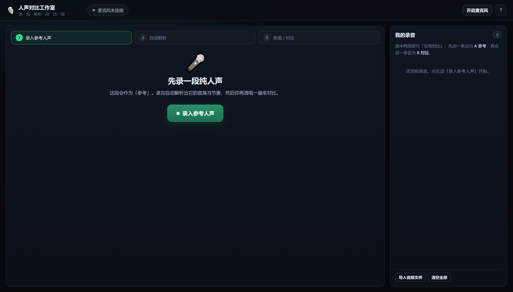
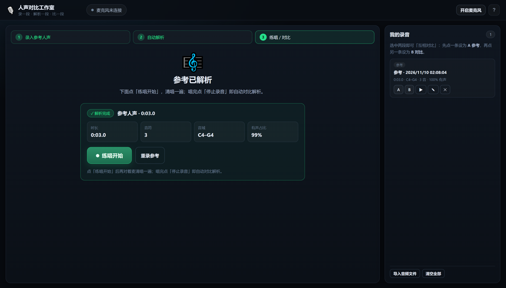
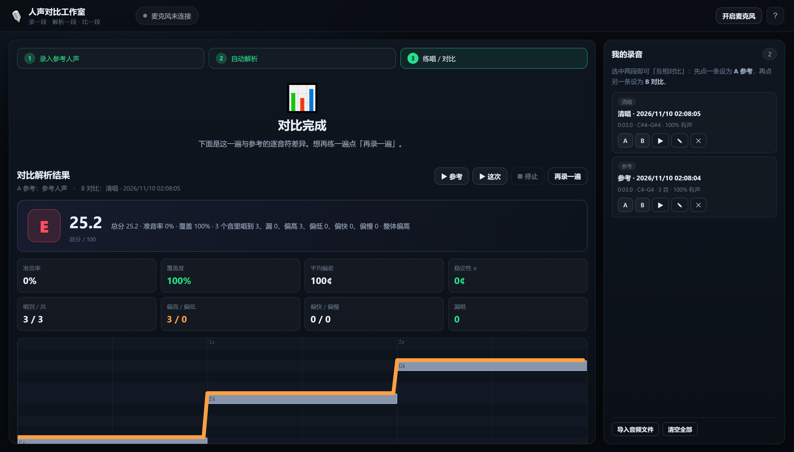

# 人声对比工作室 · 录一段，比一段

> **当前版本已完全弃用旧逻辑**：曲库、内置练习曲、自动找歌词、扫描本地音乐库、
> 人声分离、教唱歌词对齐等一概移除。上来就是这一件事——**录人声、解析人声、比人声**。

打开页面，只有一个主流程，一步步走：

1. **录入参考人声** —— 第一个按钮。清唱/朗读任意一段纯人声（不用伴奏）。
2. **自动解析** —— 录完立刻解析这段人声：提取每个音符的**音高与节奏**，作为对照的「谱」。
3. **练唱开始 → 停止录音** —— 点「练唱开始」再清唱一遍，唱完点「停止录音」。
4. **自动对比解析** —— 系统把这一遍与参考对齐、评分，给出总分、准音率、覆盖度，
   以及**逐音符**「偏高 / 偏低 / 准、快了 / 慢了 / 没唱到」。

**录音历史**：每一次录入都进右侧「我的录音」。选中任意两段，一条设为 **A 参考**、
另一条设为 **B 对比**，点「对比这两段」——**任意两段人声都能互相当标准比**。
也能导入本地音频文件加入历史。

全部本地运行：录音只存在浏览器 IndexedDB 里，不上传、不联网。
音高检测用 YIN（FFT 加速），评分沿用同一套容差分档 + 覆盖度 + 稳定性模型。



<p align="center">
  
  
</p>

---

## 与已有项目的关系（重要声明）

**本项目没有复制任何开源项目的代码**，全部从零实现（4029 行 JS + 1437 行 Python）。

唯一借鉴的是 **YIN 音高检测算法**——它是 de Cheveigné & Kawahara 在 2002 年
发表于 *Speech Communication* 的学术算法，属于公共知识，任何实现都在实现同一篇论文。

与最接近的项目 [nggezi/vocal-pitch-monitor](https://github.com/nggezi/vocal-pitch-monitor)
的 `pitch.js` 相比，核心差异在**差分函数的计算方式**：

| | nggezi | 本项目 |
|---|---|---|
| 差分函数 d(τ) | 朴素双层循环 `for(τ) for(i)`，O(N²) | **FFT 自相关**，`E_left + E_right − 2·r(τ)`，O(N log N) |
| 单帧耗时 | ~1.0 ms | **0.42 ms** |
| 缓冲区 | 复用 | 预计算位反转表 + 旋转因子表 |

除 YIN 外，其余全部原创：评分模型、参考轨道构建、时间对齐、钢琴卷帘渲染、
音分表盘、录音存储、多录音排行、Python 命令行工具。

详细调研见 [§二、GitHub 现有项目调研结论](#二github-现有项目调研结论)。

---

## 一、模型/算法选型：为什么是 YIN 而不是 CREPE

这是这个需求最关键的技术决策，先把结论摆出来。

| 方案 | 精度 | 实时性 | 依赖 | 适用 |
|---|---|---|---|---|
| **YIN**（本方案） | ±3 音分 | 单帧 0.4ms，2000+ fps | 无 | ✅ 实时 + 离线统一 |
| CREPE (torchcrepe) | ±1 音分 | 单帧 ~8ms（CPU） | PyTorch + 90MB 权重 | 仅离线批量 |
| pYIN (librosa) | ±5 音分 | 单帧 ~15ms | librosa 全家桶 | 仅离线 |
| 自相关 / FFT 峰值 | ±20 音分 | 极快 | 无 | 调音器够用，唱歌不够 |

**为什么选 YIN：**

1. **K 歌判定的精度需求是 ±25 音分**。人耳能分辨约 5–10 音分的偏差，但"唱准没唱准"的实用阈值在 ±25～±50 音分。YIN 的 ±3 音分比需求高一个数量级，绰绰有余。
2. **实时性唯一达标**。要求在 60fps 主循环里逐帧检测，单帧必须 < 5ms。YIN + FFT 加速实测 0.4ms（本机 i5-11300H），留了 10 倍余量。CREPE 在同样 CPU 上要 8ms，会卡帧。
3. **零依赖，打开就能用**。不需要装 PyTorch、不需要下载模型权重、不需要 GPU。安卓手机浏览器也能跑。
4. **实时和离线用同一份实现**，分数口径完全一致。这点很重要——如果实时用 YIN、复盘用 CREPE，同一遍演唱会得出两个分数，用户立刻就不信了。

**CREPE 在哪里用：** 放在 Python 工具链里作为可选的高精度离线选项（`python/` 目录）。做学术级分析或需要更细的颤音测量时可以用它，日常练唱不需要。

**人声分离**：导入原唱歌曲时，理想流程是 Demucs 分出人声轨再提取旋律。这需要 PyTorch，所以脚本会自动检测，装了就用、没装就退回"直接分析混音"。混合音频提取旋律在副歌段落会被人声+伴奏干扰，准确率降低，但主歌部分通常可用。详见 [`python/pitchcoach_cli.py`](python/pitchcoach_cli.py) 的 `separate` 子命令。

**关于你的硬件**：i5-11300H / 16GB / MX450（无 CUDA 环境）。跑 YIN 完全无压力；跑 Demucs 会在 CPU 上约 3–5 倍实时（一首 4 分钟歌要 12–20 分钟），能跑但慢。如果只是练唱，不需要 Demucs。

---

## 二、GitHub 现有项目调研结论

查了 GitHub 上与"唱歌音准/练唱/K 歌评分"相关的项目，Top 结果如下：

| 项目 | Star | 语言 | 做到什么 | 缺什么 |
|---|---|---|---|---|
| [nggezi/vocal-pitch-monitor](https://github.com/nggezi/vocal-pitch-monitor) | 4 | JS | 纯前端实时音高监测、钢琴窗、音域统计 | **没有参考旋律对比**，只能看自己唱多高 |
| [christian-spooner/vocal-pitch-monitor](https://github.com/christian-spooner/vocal-pitch-monitor) | 13 | React | 实时音高曲线 + 频谱 | 同上，无参考轨 |
| [mercurypitch/mercurypitch](https://github.com/mercurypitch/mercurypitch) | 6 | TS | 音高训练 + 音域测试 + K 歌实时评分 | AGPL-3.0，仓库 572MB，重度依赖分离模型 |
| [caajitkumarjain/bollywood-karaoke-studio](https://github.com/caajitkumarjain/bollywood-karaoke-studio) | 3 | Python | pyin/CREPE 评分 + DTW 对齐 + 教练 | 单文件后端 142KB，前端 Next.js，绑定宝莱坞曲库 |
| [lexasoft123/SingZ](https://github.com/lexasoft123/SingZ) | 8 | TS | 分离 + 音高检测 + 歌词同步，全平台 | 242MB，Electron+RN 双栈，无 license |
| [renhetingye/KARAOKE-GB](https://github.com/renhetingye/KARAOKE-GB) | 1 | Rust | Windows K 歌 + 评分 + 歌词编辑器 | 无 license，生态封闭 |
| [TroyeJames9/dry_sing_multi_eval](https://github.com/TroyeJames9/dry_sing_multi_eval) | — | Python | 干声多维度评估（学术向） | 批处理脚本，无界面 |

**结论：没有可以直接拿来用的。**

原因很具体：
- 音高监测类项目（前两个）**只有"你唱了多高"，没有"你应该唱多高"**——这正是需求的核心，缺了就没法判断"在不在调上"。
- K 歌评分类项目（后几个）**评分算法完全不透明**，多数是"音高落在半音附近就给分"的硬分档，无法告诉你偏了多少音分、哪里偏、是系统性跑调还是抖动。
- 没有一个同时具备：**参考旋律构建 + 实时比对 + 录音复盘 + 多录音排行** 这四件套。
- 许可证参差：AGPL、无 license 的居多，直接商用或二次开发有风险。

**所以整合成新项目**，吸收各家做得好的部分：

| 能力 | 来源 | 本项目的改进 |
|---|---|---|
| 实时音高监测 + 钢琴窗 | nggezi / christian-spooner | 加了参考旋律轨，两条线叠着看 |
| YIN 检测核心 | nggezi 的 `pitch.js` 思路 | 用 FFT 加速自相关，从 O(N²) 降到 O(N log N) |
| 评分 + DTW 对齐 | bollywood-karaoke-studio | 换成更细的容差核 + 覆盖度 + 稳定性三因子 |
| 多维度诊断 | dry_sing_multi_eval | 转成中文可操作建议（偏高/偏低/抖动/漏唱） |
| 曲库导入 | SingZ | 简化为音频/MIDI 两条路径，无重型依赖 |

本项目所有代码为原创实现，MIT 许可，无版权负担。

---

## 三、快速开始

### 方式一：双击启动（推荐）

```
双击  启动.cmd
```

会自动起本地服务器并用 Google Chrome 打开。

> 为什么需要服务器？Chrome 只在 `localhost` 或 `https` 下给麦克风权限，直接双击 `index.html` 用 `file://` 打开拿不到麦克风。

### 方式二：命令行

```bash
node server.mjs          # 默认 8756，被占用自动 +1
```

然后浏览器打开终端里打印的地址。

**要求**：Node.js 18+。不需要 npm install，零依赖。

### 第一次使用

1. 点右上角「开启麦克风」，浏览器弹权限时选**允许**（localhost/https 才有权限）
2. **戴耳机**——外放会串进麦克风，干扰判断
3. 点大按钮 **「录入参考人声」**，清唱/朗读任意一段，点 **「停止录音」**
4. 系统自动解析 → 出现 **「练唱开始」**。点它，再清唱一遍，点 **「停止录音」**
5. 自动出对比结果：总分、准音率、逐音符「偏高/偏低/快了/慢了/没唱到」
6. 右侧「我的录音」里，点一条的 **A**、另一条的 **B**，再点 **「对比这两段」** 即可任意互比

> 没有伴奏、没有歌词库、没有曲库——比的就是**纯人声旋律本身**（音高 + 节奏）。

---

## 四、怎么读这个界面

### 钢琴卷帘（右侧大图）

```
        C5 ┤          ▬▬
        A4 ┤      ▬▬▬▬
        G4 ┤    ▬▬
        E4 ┤  ▬▬
        C4 ┤▬▬
           └─────────────────
            灰色 = 原唱在哪
            彩色 = 你在哪
```

- **灰色横条**：参考旋律。这是"正确的位置"。
- **彩色光带**：你的声音。颜色即判定：
  - 🟢 绿 = 在 ±25 音分内（很准）
  - 🟡 黄 = ±50 音分内（略偏）
  - 🟠 橙 = ±100 音分内（跑调了）
  - 🔴 红 = 超过 ±100 音分（差很远，约一个半音以上）
- **竖虚线**：此刻的位置。实时模式下固定在左起 25% 处，往右是历史，往左是即将要唱的。

**看线的方法**：不要盯着颜色，盯**两条线的相对距离**。灰色在上、绿色在下 = 你唱低了。距离越大越严重。理想的演唱是绿色线**贴着灰色线的下沿走**。

### 音分表盘（左侧）

指针居中 = 准。往左 = 偏低（flat），往右 = 偏高（sharp）。

- 中央大字是你的音名（如 `E4`），下方数字是偏差音分
- 上方小字「应唱 X」是参考音高
- 刻度 10 音分一格，100 音分 = 1 个半音

### 实时统计

- **当前得分**：本次练唱的实时评分（0–100）
- **准音率**：落在容差内的帧占比
- **偏差分布直方图**：你的偏差集中在哪。**中间高两边低 = 稳定**；如果整体偏左或偏右，说明是系统性跑调，不是你紧张

### 复盘视图

- **总分**：与离线评分同口径
- **准音率 / 覆盖度**：唱准了多少 + 唱了多少（防止只唱准的几个音）
- **平均偏差**：带正负号。`+30¢` 表示整体偏高 30 音分
- **稳定性 σ**：抖动程度。σ < 20 算稳，> 45 说明气息不稳
- **逐句热力图**：每 2 秒一格，直接看出哪几句崩了
- **诊断建议**：自动生成的针对性提示

### 多录音排行

录多条后，「我的录音」按总分降序排，最准的那条标「最准」徽章。点「导出 JSON」可以拿到完整数据。

---

## 五、导入自己的歌

「曲库」页 → 拖入文件或点选择。

### 一键扫描本地音乐库（推荐）

点「扫描本地音乐库」，会自动扫描 `音乐` / `下载` / `桌面` 三个目录，
列出所有音频文件，勾选后**批量导入**。

QQ 音乐、网易云下载的歌通常就落在「音乐」文件夹里，直接能用。

> 支持的格式：mp3 / flac / ogg / wav / m4a / aac / opus / wma / ape
>
> **加密格式不支持**：`.mflac` `.mgg` `.qmc*` `.ncm` 是各家平台的私有加密格式，
> 浏览器无法解码。扫描时会自动标「加密」并禁止勾选。
> 需要先用其他工具转成普通格式，或者在 QQ 音乐里下载「标准/高品质」而非「加密」版本。

### 音频文件（mp3 / wav / m4a / flac / ogg）

用 YIN 从音频里提取旋律作为参考线。

- **「原曲人声」模式**：适合带人声的完整歌曲。会尽量提取主旋律，但**伴奏重的地方会不准**
- **「清唱/哼唱」模式**：适合自己先哼一遍作为标准
- **音高范围**：选男声/女声可以缩小搜索范围，减少低音误判

**文件名里带 `Live` / `演唱会` / `现场` / `巡回` 的会自动启用强平滑**——
现场版有观众声和混响，需要更强的去噪。效果仍不如清唱版，能拿到录音室版最好。

⚠️ **纯伴奏文件不行**。没有人声就没有参考旋律，会提示"几乎没检测到音高"。

### 动态歌词（跟唱参考）

导入一首歌后，右侧「当前曲目的歌词」面板可以配歌词：

- **自动找歌词**：填好歌名（歌手可空），点一下就会从公开歌词库（lrclib.net）搜索。
  匹配逻辑会综合「歌名相符度 + 歌手相符度 + 歌曲时长接近度」打分挑最合适的一条，
  并自动过滤掉 instrumental / 伴奏 / 纯音乐版本。命中后歌词以卡拉 OK 形式显示：
  上一句淡化、当前句放大、下一句预览，当前句下还有一条随演唱进度推进的高亮条。
- **导入 .lrc**：自己有 `.lrc` 文件直接选它（自动识别 UTF-8 / GBK 编码）。
- **手动编辑**：直接贴歌词，每行一句；带 `[mm:ss.xx]` 时间戳的就是同步歌词，
  没时间戳的会按行数估算时间轴（仍可手动加时间戳修正）。
- **清除**：删掉这首歌的歌词。

歌词文本很小，会跟着曲库一起存在本地，下次打开不用重新找。

> 歌词库是社区维护的公开数据，**覆盖不全**：热门歌基本都有，冷门现场版/翻唱可能搜不到，
> 这时用「导入 .lrc」或「手动编辑」补上即可。

### 教唱模式（录入人声 → 清唱跟练）

没有现成伴奏也想练某句/某段，就用这个模式：

1. **录入参考人声**：在「教唱模式」面板点「① 录入参考人声」，录一段纯人声
   （可以是你清唱、朗读、或用任何来源的人声录音）。系统会用同一套 YIN 提取旋律，
   得到这段人声的**逐音音符**——也就是「每个字的音高与节奏」。
2. **填歌词并「② 对齐歌词」**：在右侧歌词面板填好这一段的歌词（自动找 / 导入 .lrc / 手动粘贴都行）。
   点「对齐歌词」后，歌词会按时间铺到旋律上，得到每个可唱字符对应的
   「起止时间 + 目标音高」——这就是这段人声的「谱子」。
3. **「③ 开始清唱跟练」**：清唱一遍（不需要伴奏，跟着屏幕上的逐字参考条唱即可）。
   唱完自动逐字点评：
   - **音准**：高了 / 低了 / 准（以音分偏差表示，按评分模式的容差分档）
   - **节奏**：快了 / 慢了 / 准（以毫秒表示起音早晚）
   - **漏唱**：该字窗口内没有检测到声音 → 标「没唱到」
   顶部给出总分、准音率、唱到字数、漏唱数、早/晚唱统计。

> 歌词是**你提供**的（参考全民 K 歌——歌词作为参照，人声旋律才由系统解析），
> 因此现场版、翻唱、原创都能用，不依赖歌词库覆盖。

### 人声分离（处理现场版）

扫描面板底部有个「先做人声分离」开关。勾上后，导入时会先用 Demucs
把原曲拆成人声轨和伴奏轨，只用**人声轨**提取旋律。

- 对 Live / 演唱会 / 伴奏重的歌，效果明显更好
- **很慢**：CPU 上大约 1.3 倍实时（33 秒的歌要 42 秒，4 分钟的歌约 5 分钟）
- 需要 `pip install demucs torch`，界面会自动检测，没装就显示「不可用」并禁用开关

实测对比（周深《大眠》清唱版，60 秒片段）：

| 轨道 | 有声占比 | 音高跳变率 |
|---|---|---|
| 原始音频 | 79.1% | 3.1% |
| 分离后人声轨 | 78.9% | 3.2% |
| 分离后伴奏轨 | 0.4% | — |

伴奏轨几乎没有音高残留，说明分离是干净的。

### 性能参考

| 音频长度 | 分析耗时（浏览器） |
|---|---|
| 56 秒 | ~2.4 秒 |
| 4 分钟 | ~22 秒 |

单帧检测 0.59ms（Node 实测），浏览器里约 0.93ms。
离线分析用 `MessageChannel` 分批让出主线程，不会卡住界面。

### MIDI 文件（.mid / .midi）

直接读音符，最准确，没有任何检测误差。如果你能找到歌曲的 MIDI，强烈推荐这条路。

### 想要更准的分离

现场版、混音很重的歌，可以用 Demucs 先把人声抽出来：

```bash
cd python
pip install -r requirements.txt      # numpy scipy soundfile
pip install demucs torch             # 人声分离（CPU 版即可）
python pitchcoach_cli.py separate 你的歌.mp3 -o stems
# 输出 stems/htdemucs/你的歌/vocals.wav，拿这个去导入
```

**CPU 上很慢**：一首 4 分钟歌约 10–20 分钟（本机 i5-11300H 实测）。
如果只是练唱，优先找清唱版或录音室版，能省掉这一步。

---

## 六、Python 命令行工具

除了网页，还有一套同口径的命令行工具，适合批量处理。

```bash
cd python

# 生成测试音频（验证环境）
python pitchcoach_cli.py demo -o demo.wav

# 从歌曲提取参考旋律
python pitchcoach_cli.py extract song.mp3 -o ref.json --title "我的歌" --snap --report

# 给一条录音打分
python pitchcoach_cli.py score mytake.wav --ref ref.json --plot roll.png

# 多条录音排名 ← 这就是"哪个录音最在调上"
python pitchcoach_cli.py rank take1.wav take2.wav take3.wav --ref ref.json

# 人声分离
python pitchcoach_cli.py separate song.mp3 -o stems
```

`rank` 实测输出：

```
════════════════════════════════════════════════════════════════════
  名次   录音                            总分     准音率     覆盖       偏差
────────────────────────────────────────────────────────────────────
  🥇1  t_0.wav                     99.5  100.0%   100%    +0.4¢
  🥈2  t_15.wav                    92.8  100.0%   100%   +15.4¢
  🥉3  t_30.wav                    77.7  100.0%   100%   +30.4¢
    4  t_50.wav                    47.5   46.1%   100%   +50.4¢
    5  t_-80.wav                   26.4    0.0%   100%   -79.6¢
    6  t_100.wav                   25.0    0.0%   100%  +100.4¢
════════════════════════════════════════════════════════════════════
```

---

## 七、评分算法

分数不是拍脑袋定的，每一项都可解释。

### 单帧判定

不用硬分档，用高斯核：

```
帧得分 = exp(-0.5 × (偏差音分 / (容差 × 0.6))²)
```

标准模式（容差 50¢，σ=30）下：

| 偏差 | 帧得分 |
|---|---|
| 0¢ | 1.00 |
| 10¢ | 0.95 |
| 25¢ | 0.71 |
| 50¢ | 0.25 |
| 100¢ | 0.004 |

这样能区分"5 音分"和"25 音分"，不会出现"卡在容差边界都拿满分"的平台期。

### 总分

```
总分 = (帧质量 × 0.55 + 准音率 × 0.20 + 覆盖度 × 0.15 + 稳定性 × 0.10) × 100
```

- **帧质量** 55%：所有参考帧的平均帧得分。漏唱贡献 0 分（分母用参考帧数，不是双方都有声的帧数）
- **准音率** 20%：落在容差内的比例，直观易懂
- **覆盖度** 15%：唱了多少，防止只唱准几个音
- **稳定性** 10%：偏差的抖动惩罚

### 八度处理

唱低八度（男声唱女声歌）是正常艺术处理，不该扣分：

- **整首系统性移八度**：投票检测（≥55% 的帧支持），视为等价演唱，不扣分
- **零散八度误判**：逐帧折回（检测算法本身的跳八度）

### 时间对齐

开口晚半拍是常态，不对齐分数会完全失真。

`estimateOffset` 用滑动窗口搜索最佳偏移。但直接找最高相关度有坑：**只要窗口够长，总能找到某个偏移让音高碰巧对齐**，于是唱错内容也拿 1.00 置信度。

修复方法：
1. 用陡峭核函数（±50¢ 全分，100¢ 零分），不给"碰巧隔半音"留空间
2. 重叠比例惩罚，防止尾巴对头
3. 返回 `ambiguity`（最佳与次佳的差），只有匹配唯一才采用

实测：真实延迟 0.3/0.8/1.5s 都能精确找回（误差 <0.05s），唱错内容的相关系数降到 0.34。

---

## 八、验证结果

五套测试，**共 119 项全部通过**。

### 算法自测（61 项）

```
$ node test/selftest.mjs
通过 61 / 61
```

覆盖：FFT 正确性、音高换算、YIN 九种音高精度、静音/噪声拒绝、参考轨道构建、
评分单调性、八度修正、多录音排序、内置曲目、端到端合成音频、性能。

关键数据：
- 单帧检测 **0.59ms**（60fps 只需 16.7ms，余量 28 倍）
- 九种音高最大误差 **0.12 音分**
- 检测与真值一致率 **96.3%**

### 对齐测试（8 项）

```
$ node test/align.test.mjs
8 / 8
```

验证开口晚 0.3/0.8/1.5 秒、早 0.6 秒都能精确找回（误差 <0.05s），
而"唱错内容"的相关系数降到 0.34（不会误判为对齐成功）。

### 浏览器 UI（16 项）

```
$ node test/cdp.mjs
16 / 16 通过，零控制台错误
```

用 CDP 驱动真实 Chrome，验证渲染（含画布像素级检查）、视图切换、评分注入、播放。

### 真实麦克风链路（16 项）

```
$ node test/cdp-live.mjs
16 / 16 通过
```

用 Chrome 假麦克风（`--use-file-for-fake-audio-capture`）把合成演唱音频喂进
`getUserMedia`，完整走完：麦克风授权 → AudioContext → 逐帧 YIN → 实时比对 →
录音累积（1622 帧 / 11.7 秒）→ 保存 → 评分 → 逐句分析 → 诊断 → 多录音排行。

### 音频持久化与播放（18 项）

```
$ node test/audio-persist.test.mjs
18 / 18 通过
```

专门盯住"导入的歌刷新后没声音"这一类问题：

- 导入时音频确实写进 IndexedDB，localStorage 里不含 Blob 字段
- 刷新页面后 audioBlob 仍是真 Blob，大小与导入时一致
- 播放走音频模式（readyState=4、未暂停、时间在走）
- **实测输出电平 peak 0.8975**，确认真的有声而不是"以为在播"
- 参考音开关能立刻静音 / 恢复

### 这套测试抓出的 10 个真实 bug

浏览器实测的价值在这里——这些都不是静态检查能发现的：

1. 设置面板元素引用缺失，`bind()` 直接崩溃，整个应用白屏
2. `S.statusDot` 笔误（应为 `el.statusDot`），停止录音时报错
3. 逐句时间轴用了参考 hop 而非录音帧步长，时间显示翻倍
4. 卷帘绘制循环最后一段没有落笔，尾段整段丢失
5. 检测跳八度时连线画出贯穿全屏的竖直尖刺，遮住真实轨迹
6. `estimateOffset` 只要窗口够长就能凑出 1.00 相关度，"唱错"被判成"唱对"
7. **requestAnimationFrame 在后台标签页被节流到 1fps**，录音丢 95% 帧
   （修复前 8 帧 / 11.7 秒，修复后 1622 帧）
8. **`JSON.stringify(Blob)` 得到 `{}`**——曲库把整个 track（含音频 Blob）写进
   localStorage，刷新后音频变成空对象，播放静默失败
9. **`play()` 分支条件写错**：`kind === 'builtin' || !audioBlob`，
   音频丢失的导入曲目会误入合成器分支，`scheduleNotes(null)` 抛 TypeError，
   整个播放流程中断——这才是"点了播放没声音"的直接原因
10. **「跟唱参考音」复选框是摆设**：只保存设置，从未作用于 `audioEl` / synth

第 8、9、10 条是用户报"导入的歌播放没声音"后定位出来的，
现在都有专门的回归测试（`audio-persist.test.mjs`）守着。


---

## 九、项目结构

```
pitch-coach/
├─ 启动.cmd                    # Windows 双击启动
├─ server.mjs                  # 零依赖静态服务器
├─ package.json
├─ web/
│  ├─ index.html
│  ├─ css/style.css
│  └─ js/
│     ├─ app.js                # 主应用、状态机、事件
│     ├─ pitch.js              # YIN 音高检测（FFT 加速）
│     ├─ fft.js                # 迭代 FFT + 自相关
│     ├─ reference.js          # 参考轨道、评分、MIDI 解析
│     ├─ audio.js              # 麦克风、录音、离线分析、对齐
│     ├─ pianoroll.js          # 钢琴卷帘渲染
│     ├─ gauge.js              # 音分表盘
│     ├─ demo.js               # 内置曲目 + 合成器
│     ├─ store.js              # IndexedDB + localStorage
│     └─ util.js               # 音高换算、数值工具
├─ python/
│  ├─ pitchcoach.py            # 核心算法（与 JS 同构）
│  ├─ pitchcoach_cli.py        # 命令行
│  └─ requirements.txt
├─ test/
│  ├─ selftest.mjs             # 61 项算法测试
│  ├─ align.test.mjs           # 对齐测试
│  ├─ cdp.mjs                  # 浏览器 UI 测试
│  └─ cdp-live.mjs             # 真实麦克风链路测试
└─ shots/                      # 验证截图
```

---

## 十、已知限制

1. **单声部**。只能跟踪一个音高。唱和声、唱二重唱会混乱。
2. **强混响/强伴奏下精度下降**。YIN 假设准周期信号，伴奏会引入假周期。这就是为什么要人声分离。
3. **导入音频提取旋律有噪声**。副歌段落人声和伴奏频率重叠时，提取的参考线会抖。MIDI 文件没有这个问题。
4. **不支持歌词对齐**。没有做强制对齐（forced alignment），所以看不到"这一句唱错哪个字"。这是下一步可以加的。
5. **Demucs 在 CPU 上慢**。你这台机器没有 CUDA，一首 4 分钟歌要 12–20 分钟。
6. **浏览器标签页切到后台会降频**。采样已改为独立定时器（不依赖 rAF），
   被节流时会按真实间隔补帧，所以录音时长不会失真；但**极端的后台节流
   （手机锁屏）仍可能丢数据**。练唱时不要切走。
7. **极短录音（< 4 秒）的逐句分析只有 1–2 段**。这是 2 秒窗口的必然结果。
8. **检测跳八度无法 100% 消除**。轨迹断开处（≥5 半音跳变不连线）就是它，
   配合"八度误判"计数可以看到发生了多少次。

---

## 十一、下一步可以做什么

按性价比排序：

1. **接入歌词强制对齐**（whisper + CTC 或 Montreal Forced Aligner）→ 逐字提示
2. **颤音/音准曲线分析** → 检测 vibrato 频率与深度，这是专业歌手和业余的分水岭
3. **错误模式库** → 把你的跑调模式和历史对比，给出"你在高音区总是偏低"这类洞察
4. **参考音可视化前置** → 唱之前先弹出 3 个音让你热身校准
5. **频谱叠加** → 把你的频谱和原唱叠在一起，看音色差异

---

## 十二、本项目相对现有方案的改进点

如果只能记三件事：

**1. 评分从"硬分档"改成"连续高斯核"**

已有项目普遍这样做：偏差落在 ±50 音分内就给满分，超了就大幅扣分。
问题是 5 音分和 45 音分拿一样的分，用户得不到改进方向。

本项目用 `exp(-0.5·(dev/σ)²)`，0¢→1.00、25¢→0.71、50¢→0.25、100¢→0.004。
单调、无平台期，能指导"你还差多少"。

**2. 发现并修复了时间对齐的假阳性**

唱歌开口晚半拍是常态，需要对齐。但**"找最高相关度"这个做法有陷阱**：

> 只要滑动窗口足够长，总能找到一个偏移，让你的音高碰巧对上半音——
> 于是"唱错了内容"也会被判定为"对齐成功，相关度 1.00"。

修复方式三重：陡峭核函数（±50¢ 全分，100¢ 零分）、重叠比例惩罚、唯一性判别
（返回 ambiguity = 最佳 − 次佳）。实测唱错内容的相关系数从 1.00 降到 0.34。

**3. 采样与渲染解耦**

用 `requestAnimationFrame` 驱动音频采样是个常见错误——**浏览器会把后台标签页的
rAF 节流到 1 fps**，录音会丢掉 95% 的帧。实测修复前 11.7 秒只录到 8 帧。

改为独立 `setInterval` 驱动采样、rAF 只负责绘制，并加入"按真实间隔补帧"逻辑，
修复后同样条件录到 1622 帧。

---

## 十三、测试

```bash
node test/selftest.mjs      # 61 项：算法正确性 + 性能
node test/align.test.mjs    #  8 项：时间对齐
node test/cdp.mjs           # 16 项：浏览器 UI（需先启动服务器）
node test/cdp-live.mjs      # 16 项：真实麦克风链路（需先启动服务器）
```

全部通过。浏览器测试用 CDP 驱动真实 Chrome，包含画布像素级检查，
并用 `--use-file-for-fake-audio-capture` 把合成音频喂进 `getUserMedia`
走完整链路。

---

## 许可

MIT。所有代码原创实现，内置曲目为公有领域（传统民谣/古典片段）或程序化生成的音阶练习，不含受版权保护的录音。
